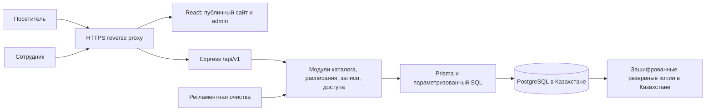
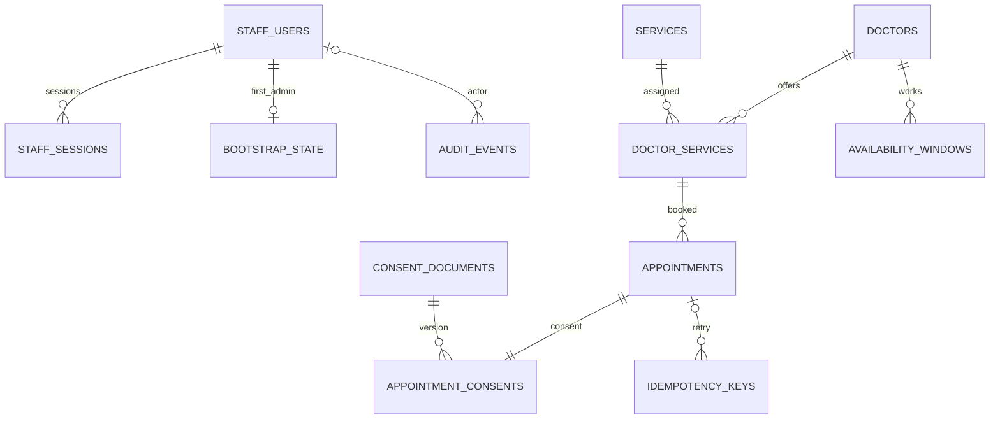

# Сайт частной клиники Казахстана — архитектурный план

Статус: **этап 5 реализован; работа остановлена перед этапом 6**. Готовы БД/транзакционное ядро, авторизация сотрудников с MFA/RBAC и API каталога/сотрудников/аудита. HTTP API записи/расписания подключены; клиентский сайт и форма записи реализованы, админ-панель остаётся этапу 6.
Планирование: 04.11.2026; этапы 2–4: 05.11.2026. План интеграции Stitch: [docs/DESIGN-INTEGRATION.md](docs/DESIGN-INTEGRATION.md); основа: [docs/FOUNDATION.md](docs/FOUNDATION.md); актуальная БД и гарантии: [docs/DATABASE.md](docs/DATABASE.md).

Результаты проверок и полный перечень изменений: [docs/STAGE-1-REPORT.md](docs/STAGE-1-REPORT.md).

Результаты этапа 2 и оставшиеся риски: [docs/STAGE-2-REPORT.md](docs/STAGE-2-REPORT.md). Отчёт этапа 1 сохранён как исторический снимок.

Актуальный результат и изменённые файлы этапа 3: [docs/STAGE-3-REPORT.md](docs/STAGE-3-REPORT.md). Вход, выдача/восстановление доступа и границы production: [docs/AUTH.md](docs/AUTH.md); реализованные HTTP-контракты: [docs/openapi.json](docs/openapi.json).

## Локальный запуск каркаса

```sh
npm ci
npm run setup
npm run db:up
npm run db:generate
npm run db:validate
npm run db:deploy
npm run db:seed
npm run db:check
npm run dev
```

Нужны Node.js 24/npm 11 и Docker Linux containers. Web — `http://127.0.0.1:5173`, API — `http://127.0.0.1:3001`; PostgreSQL — только loopback `55432`. Открывается клиентский сайт в стиле Stitch с каталогом, специалистами и формой записи (RU/KK). Seed — только вымышленные данные, без пациентов/записей/действующего пароля администратора. Команды БД и безопасный тестовый runner описаны в [DATABASE.md](docs/DATABASE.md).

Первый ADMIN выдаётся отдельно: `npm run staff:bootstrap` в приватной TTY с собственным паролем и офлайн созданным TOTP key; в ходе реализации рабочий ADMIN не создавался. Повторное подключение/восстановление существующего сотрудника — `npm run staff:credentials`. Перед использованием прочитать [AUTH.md](docs/AUTH.md). Setup добавляет отсутствующие локальные auth keys, не выводя секреты. Проверки: `npm test`, `npm run test:integration`, `npm run typecheck`, `npm run lint`, `npm run format:check`, `npm run openapi:check`, `npm run db:validate`, `npm run smoke`.

## 1. Результат изучения директории

При первичном планировании директория была пуста. Теперь добавлен ZIP Stitch: 5 публичных HTML-экранов, desktop-экран админ-панели, 6 PNG и DESIGN.md. Архив безопасно распакован в `design-reference/stitch_premium_medical_clinic_portal/`, скрипты не исполнялись. Git-репозиторий содержит базу этапа 2 и сохранённый этап 3. Ниже разграничены каркас этапа 1 и будущие бизнес-функции.

## 2. Цель и границы MVP

Коммерческий сайт представляет клинику, помогает выбрать услугу и врача, показывает свободное время и принимает заявку. Сотрудники управляют каталогом, расписанием и записями через защищённую админ-панель.

Предлагаемые допущения, подлежащие подтверждению:

- Одна клиника, один адрес, один врач принимает одного посетителя одновременно. Кабинеты, оборудование и несколько филиалов пока не моделируются.
- Публичный интерфейс и юридические тексты — на казахском и русском; валюта — KZT. Переводы проверяет клиника.
- Stitch использует Алматы: рабочее синтетическое допущение — `Asia/Almaty`, один адрес. Финальный город подтверждает клиника; все посетители видят время именно клиники с явной подписью. Телефоны, адрес, лицензия и обещания из макетов не считаются проверенными реквизитами.
- Одна заявка относится к одной услуге и одному врачу. Для услуги задана длительность и фиксированная цена; врач должен быть привязан к этой услуге.
- Авторизация посетителя не нужна. Форма содержит имя, телефон и отдельное согласие на обработку данных; технически передаёт также выбранные услугу, врача, время и версию согласия.
- Новая заявка `PENDING` сразу занимает интервал, но приём подтверждает сотрудник. На экране явно указано: «Заявка принята, ожидайте подтверждения клиники». Автоматического истечения заявки в MVP нет; клиника ежедневно разбирает очередь.
- Расписание ведётся конкретными рабочими интервалами по датам. Перерыв — разрыв между интервалами; выходной/отпуск — отсутствие интервалов. Бессрочные правила повторения отложены.
- Нет личного кабинета пациента, оплаты, МИС/CRM, SMS, рассылок, медицинских анкет, файлов посетителей и интеграций с государственными системами. Эти функции требуют отдельных решений.
- Онлайн-форма предварительно предназначена для совершеннолетнего заявителя; сценарий записи ребёнка или представителя нужно согласовать до расширения формы.

## 3. Страницы и пользовательские сценарии

| Раздел                   | Содержимое и действие                                                                                    |
| ------------------------ | -------------------------------------------------------------------------------------------------------- |
| Главная                  | Направления, врачи, преимущества с проверяемыми фактами, адрес, часы работы, кнопка записи               |
| Услуги и карточка услуги | Описание, длительность, цена, подходящие врачи, переход к записи                                         |
| Цены                     | Единый источник цен из каталога услуг; без отдельного дублирующего прайса                                |
| Врачи и карточка врача   | Специальность, квалификация, согласованная биография, фото, услуги и запись                              |
| Контакты                 | Адрес, телефон, часы работы, маршрут, реквизиты и сведения о лицензии                                    |
| Онлайн-запись            | Услуга → врач → дата → свободное время → имя/телефон/согласие → результат                                |
| Правовые страницы        | Политика обработки данных, актуальный текст согласия, порядок обращения и отзыва согласия                |
| Админ-панель             | Вход, очередь заявок, календарь, врачи, услуги, рабочие интервалы; сотрудники и аудит для администратора |

Для публичных страниц: маршруты `/ru/...` и `/kk/...`, отдельные URL карточек, метаданные, canonical/hreflang, sitemap, корректная 404, структурированные сведения о клинике без выдуманных отзывов. На этапе UI выбрать совместимое с Vite решение для prerender публичного контента: HTML должен содержать основную информацию до выполнения JavaScript. Использовать только публичные DTO; обновление SEO-снимка каталога включить в управляемый процесс публикации. Админ-панель закрыть от индексации, при этом безопасность обеспечивается API.

Адаптивность: мобильные экраны от 360 px, планшеты и desktop; календарь и таблицы админ-панели должны иметь пригодное мобильное представление. Предусмотреть клавиатурное управление, подписи полей, видимый фокус, достаточный контраст, состояния загрузки, отсутствия времени, ошибки сети, истёкшего времени и конфликта записи. Ориентир доступности — WCAG 2.2 AA.

## 4. Архитектура

**Монорепозиторий и модульный монолит.** React + Vite + TypeScript для интерфейса; Node.js + Express + TypeScript для REST API; PostgreSQL + Prisma для данных. Для MVP нет необходимости в микросервисах, Redis или отдельном брокере.



В production сайт и API доступны на одном origin: `/` обслуживает frontend, `/api/v1` — Express. PostgreSQL недоступен из Интернета. Для разработки Vite проксирует `/api` в локальный backend.

Слои backend: `router → middleware → controller → service → repository → Prisma/PostgreSQL`. Контроллер разбирает HTTP, service реализует бизнес-правила и границы транзакций, repository выполняет запросы. Общие DTO не раскрывают Prisma-модели и закрытые поля.

| Модуль           | Ответственность                                                         |
| ---------------- | ----------------------------------------------------------------------- |
| `auth` / `staff` | Сотрудники, роли, пароль, MFA, сессии и отзыв доступа                   |
| `catalog`        | Врачи, услуги, связи врач–услуга, публикация и архивирование            |
| `schedule`       | Рабочие интервалы, вычисление доступного времени, ограничения календаря |
| `appointments`   | Создание, подтверждение, перенос, отмена, статусы и идемпотентность     |
| `privacy`        | Версии согласия, фиксация принятия/отзыва, сроки хранения и очистка     |
| `audit`          | События действий сотрудников и чтения персональных данных               |

Frontend: TanStack Query и Zod на этапе основы; React Router и React Hook Form добавляются на соответствующем функциональном этапе. Backend повторно валидирует вход независимо от frontend. CSS Modules и токены Stitch сохраняют его стили без runtime Tailwind CDN. Палитра и типографика описаны в плане интеграции; внешние шрифтовые запросы не используются.

## 5. Предлагаемая структура проекта

```text
clinic/
├── README.md
├── AGENTS.md
├── TASKS.md
├── package.json                  # npm workspaces и общие команды
├── package-lock.json
├── tsconfig.base.json
├── .env.example                  # только названия переменных и безопасные примеры
├── .gitignore
├── apps/
│   ├── web/
│   │   ├── package.json
│   │   ├── vite.config.ts
│   │   ├── public/               # согласованные фото/логотип; без данных заявителей
│   │   └── src/
│   │       ├── app/              # router, providers, конфигурация
│   │       ├── pages/            # public/, booking/, admin/
│   │       ├── features/         # booking, auth, catalog, schedule
│   │       ├── components/
│   │       ├── api/              # HTTP-клиент и query keys
│   │       ├── i18n/             # ru, kk
│   │       ├── content/          # контакты и утверждённый статический контент
│   │       └── styles/
│   └── api/
│       ├── package.json
│       ├── prisma.config.ts     # если требуется выбранной версией Prisma
│       ├── prisma/
│       │   ├── schema.prisma
│       │   ├── migrations/      # включая ручной SQL для ограничений
│       │   └── seed.ts          # только синтетические данные
│       ├── src/
│       │   ├── app.ts
│       │   ├── server.ts
│       │   ├── config/
│       │   ├── modules/         # auth, staff, catalog, schedule, appointments, privacy, audit
│       │   ├── middleware/     # auth, RBAC, CSRF, rate limit, validation, errors
│       │   ├── infrastructure/ # prisma, encryption, logger
│       │   └── jobs/           # очистка сессий, ключей повторов, персональных данных
│       └── tests/              # integration с настоящим PostgreSQL
├── packages/
│   └── contracts/              # Zod-схемы и DTO public/admin, без серверных секретов
├── tests/e2e/
├── docs/                       # OpenAPI, решения, эксплуатационные инструкции
├── infra/                      # local compose, deployment, backup/restore
└── .github/workflows/           # CI после выбора Git-хостинга
```

Это целевое дерево всего проекта. В этапах 1–2 созданы каркас, модели, миграции, синтетический seed и внутренний транзакционный сервис. Этап 3 добавляет `modules/security` (auth/staff/audit, HTTP adapter), `modules/catalog` (DTO/services) и общие `booking/catalog-mutations`. HTTP-обработчики вызывают сервисы; каталожные изменения и проверка доступа используют одну транзакцию. Booking/schedule HTTP, формы и админ-панель остаются следующим этапам. Контакты и обычные страницы MVP редактируются через код/публикацию; полноценная CMS не требуется. Фото врачей выбираются из подготовленных разрешённых assets, произвольная загрузка файлов не предусмотрена.

## 6. Схема данных

Имена ниже — реализованные SQL-таблицы; Prisma-модели сопоставляются через `@@map`/`@map`. Доменные PK — UUID, генерируемые приложением; технические исключения указаны отдельно. Времена событий — `timestamptz`, даты показываются в часовом поясе клиники. У изменяемых сущностей есть `created_at`, `updated_at`; у журналов — неизменяемое время события. Денежные значения — `numeric(12,2)`, никогда float.

| Таблица                | Поля и связи                                                                                                                                                                                                                                                                                                                                                             |
| ---------------------- | ------------------------------------------------------------------------------------------------------------------------------------------------------------------------------------------------------------------------------------------------------------------------------------------------------------------------------------------------------------------------ |
| `staff_users`          | `id PK`, `email UNIQUE` после нормализации, `password_hash`, `role ADMIN/RECEPTIONIST`, `is_active`, `mfa_secret_ciphertext?`, `mfa_enabled`, `mfa_last_used_counter?`, `password_changed_at`                                                                                                                                                                            |
| `staff_sessions`       | `id PK`, `user_id FK`, `token_hash UNIQUE`, `auth_stage CHALLENGE/AUTHENTICATED`, `mfa_verified_at?`, `created_at`, `last_seen_at`, `expires_at`, `revoked_at?`; токен в БД хранится только как хеш                                                                                                                                                                      |
| `bootstrap_state`      | Boolean PK, CHECK true, `admin_user_id UNIQUE FK`, `completed_at`; единственный неизменяемый marker первого ADMIN, доступ на запись только offline operator                                                                                                                                                                                                              |
| `rate_limit_buckets`   | `key_hash char(64) PK`, `attempts`, `resets_at` с индексом; общие атомарные лимиты, HMAC вместо открытых IP/email/token                                                                                                                                                                                                                                                  |
| `doctors`              | `id PK`, `slug UNIQUE`, `name_ru`, `name_kk`, `specialty_ru`, `specialty_kk`, `bio_ru`, `bio_kk`, `photo_asset_key?`, `is_active`                                                                                                                                                                                                                                        |
| `services`             | `id PK`, `slug UNIQUE`, `name_ru`, `name_kk`, `description_ru`, `description_kk`, `duration_minutes`, `price_kzt`, `is_active`                                                                                                                                                                                                                                           |
| `doctor_services`      | Составной PK `(doctor_id, service_id)`, оба поля FK; `is_active`. Назначает услуги врачу, не переопределяет цену или длительность                                                                                                                                                                                                                                        |
| `availability_windows` | `id PK`, `doctor_id FK`, `starts_at`, `ends_at`; конкретный рабочий интервал без персональных данных и свободных комментариев                                                                                                                                                                                                                                            |
| `appointments`         | `id PK`, `reference UNIQUE` (случайный публичный номер, не средство авторизации), `doctor_id`, `service_id`, составной FK на `doctor_services`, `starts_at`, `ends_at`, `duration_minutes_snapshot`, `price_kzt_snapshot`, `status`, `patient_name_ciphertext?`, `phone_ciphertext?`, `encryption_key_version?`, `version`, `anonymized_at?`, `created_at`, `updated_at` |
| `consent_documents`    | `id PK`, `version UNIQUE`, `text_ru`, `text_kk`, `content_sha256`, `published_at`, `retired_at?`; опубликованный текст неизменяем, новая редакция — новая строка                                                                                                                                                                                                         |
| `appointment_consents` | `appointment_id PK/FK`, `document_id FK`, `accepted_at`, `locale ru/kk`, `method WEB_CHECKBOX`, `withdrawn_at?`; нет IP, user-agent или дополнительного идентификатора пациента                                                                                                                                                                                          |
| `idempotency_keys`     | `key_hash PK`, `request_hmac`, `appointment_id FK?`, `created_at`, `expires_at`; TTL предварительно 24 часа. Повторный ответ формируется из безопасного DTO, исходное тело запроса не хранится                                                                                                                                                                           |
| `audit_events`         | `id PK`, `actor_user_id FK?`, `action`, `entity_type`, `entity_id?`, `request_id`, `created_at`, ограниченные технические metadata; без имени, телефона, секретов, полного request/response или снимков записи                                                                                                                                                           |

`patient_name_ciphertext` — имя посетителя из формы, не отдельная карточка пациента. Контакты зашифрованы на уровне приложения с аутентифицированным шифрованием и управлением ключами отдельно от БД; набор ciphertext включает nonce/tag. Реализация — через проверенную библиотеку, формат с версией ключа, ротация и восстановление ключей входят в эксплуатационный план. Финальный выбор криптосредств зависит также от применимых требований РК.



Ограничения и индексы:

- `NOT NULL` для обязательных бизнес-полей; `CHECK duration_minutes > 0`, `price_kzt >= 0`, `starts_at < ends_at`, положительная `version`. У записи проверяется соответствие конца интервала сохранённой длительности.
- Для персональных полей CHECK допускает либо полный комплект зашифрованных контактов с версией ключа и `anonymized_at IS NULL`, либо все эти поля NULL с заполненным `anonymized_at`. Это не разрешает создание заявки без контактов.
- FK по умолчанию `RESTRICT`: врач, услуга, назначение услуги и версия согласия не удаляются, если на них есть ссылки. Вместо удаления каталога — деактивация. Удаление сотрудника не является штатной операцией: аккаунт отключается, сессии отзываются.
- B-tree: `appointments(doctor_id, starts_at)`, `appointments(doctor_id, service_id)`, `appointments(service_id)`, `appointments(status, starts_at)`, `availability_windows(doctor_id, starts_at)`, `doctor_services(service_id)`, `staff_sessions(user_id)`, `staff_sessions(expires_at)`, `appointment_consents(document_id)`, `idempotency_keys(expires_at)`, `idempotency_keys(appointment_id)`, `audit_events(actor_user_id, created_at)`, `audit_events(entity_type, entity_id, created_at)`, `audit_events(created_at)`.
- GiST exclusion constraints для непересечения записей одного врача и непересечения его рабочих интервалов; extension `btree_gist` должен поддерживаться хостингом.
- Гарантия «у каждой записи есть согласие» обеспечивается единой транзакцией и отложенными constraint triggers: commit записи без доказательства согласия запрещён даже для прямого SQL. Обычный FK сам по себе этого не гарантирует.
- Индексы и сроки жизни audit отдельно проверяются на реальном профиле нагрузки; HMAC и технические идентификаторы также рассматриваются как потенциально связываемые данные.

## 7. Расписание и защита от двойного бронирования

Свободные слоты не сохраняются отдельными строками. Сервер вычисляет их из рабочих интервалов, длительности выбранной услуги и занятых интервалов. Шаг начала предварительно 15 минут от начала рабочего интервала; длительность может отличаться от шага. Весь приём должен помещаться в одном рабочем интервале. Нельзя пересекать перерыв, записываться в прошлое или к неактивному врачу/услуге/назначению. Предварительно: минимум 60 минут до начала, горизонт записи 60 дней; значения согласуются на этапе 1.

Проверка `SELECT`, а затем отдельный `INSERT` недостаточна. В этапе 2 реализованы и проверены следующие exclusion constraints (полный SQL с CHECK и триггерами находится в миграциях):

```sql
CREATE EXTENSION IF NOT EXISTS btree_gist;

ALTER TABLE appointments
  ADD CONSTRAINT appointment_valid_interval CHECK (starts_at < ends_at),
  ADD CONSTRAINT appointments_no_overlap
  EXCLUDE USING gist (
    doctor_id WITH =,
    tstzrange(starts_at, ends_at, '[)') WITH &&
  ) WHERE (status <> 'CANCELLED');

ALTER TABLE availability_windows
  ADD CONSTRAINT availability_valid_interval CHECK (starts_at < ends_at),
  ADD CONSTRAINT availability_no_overlap
  EXCLUDE USING gist (
    doctor_id WITH =,
    tstzrange(starts_at, ends_at, '[)') WITH &&
  );
```

Полуоткрытые интервалы `[start, end)` допускают соседние приёмы: 10:00–10:30 и 10:30–11:00. Приёмы 10:00–10:45 и 10:30–11:00 одного врача конфликтуют. Проверяется весь интервал, а не только совпадение начала. PostgreSQL поддерживает такие ограничения; для возможностей, не представленных выбранной Prisma schema, используется проверяемый ручной SQL в миграциях ([PostgreSQL](https://www.postgresql.org/docs/current/rangetypes.html#RANGETYPES-CONSTRAINT), [Prisma Migrate](https://www.prisma.io/docs/orm/prisma-migrate/workflows/unsupported-database-features)).

Создание заявки:

1. Проверить DTO, лимиты запросов, согласие и случайный `Idempotency-Key` с энтропией не менее 128 бит. Клиент сохраняет один ключ на попытку и повторяет его после сетевого сбоя.
2. Начать короткую транзакцию. Сначала захватить PostgreSQL advisory xact lock хеша ключа повтора, проверить существующий результат; затем блокировать врача `SELECT ... FOR UPDATE` и услугу. Ни одна операция не захватывает advisory-ключ после врача. Каталог и время перечитываются после ожидания блокировки.
3. Уникальность `key_hash` и HMAC канонических параметров защищают от дубля. Совпавшие ключ/параметры возвращают тот же reference и текущее безопасное состояние; другой payload — `IDEMPOTENCY_CONFLICT`. TTL 24 часа, существующий просроченный ключ — `IDEMPOTENCY_EXPIRED`. Доверенный fingerprint контактов формируется будущим privacy-модулем, не приходит от посетителя. Повтор проверяется до занятости/активности. Это реализованные доменные коды; HTTP 409 и public DTO будут подключены на этапе 4.
4. Под блокировкой врача повторно вычислить допустимость начала, попадание в рабочий интервал, отсутствие пересечения и актуальность версии согласия. Конец и цену вычисляет сервер; клиент их не назначает. Проверить ожидаемые клиентом цену/длительность, при изменении вернуть `409 OFFER_CHANGED` и предложить перепроверить выбор.
5. Создать `appointments(PENDING)`, `appointment_consents` и ключ повтора в одной транзакции. На этапе 2 сервис принимает уже запечатанные контакты; production privacy-модуль ещё не подключён. После commit возвращается внутренний безопасный результат, без контактов; будущий controller выберет public DTO.
6. Нарушение именно `appointments_no_overlap` (SQLSTATE `23P01`) преобразовать в `409 SLOT_UNAVAILABLE`; формат ошибки выбранного Prisma adapter проверить интеграционным тестом. Сериализацию/дедлок обрабатывать ограниченными повторами. Остальные ошибки БД не маскировать как занятый слот.

Все изменения расписания и деактивация врача/его услуги используют ту же блокировку врача. Изменение услуги блокирует строку услуги и не захватывает затем врачей. Единый порядок для операций с несколькими сущностями: врачи по UUID → услуги по UUID → запись. Удаление/сокращение рабочего интервала отклоняется, если будущий неотменённый приём окажется вне расписания; сначала сотрудник переносит или отменяет запись. Изменение цены/длительности услуги не меняет snapshots уже созданных записей.

Перенос атомарно обновляет одну запись и её snapshots: блокируются исходный и целевой врач в установленном порядке, проверяются актуальный `version`, статус и новое время; при конфликте исходная запись сохраняется. При изменении врача другим конкурентным переносом операция перечитывает данные и повторяется либо возвращает `409`. Сетевых вызовов внутри транзакции нет. Exclusion constraint сохраняется даже при нескольких экземплярах API; блокировка врача дополнительно предотвращает гонку записи с изменением расписания.

Статусы: `PENDING → CONFIRMED | CANCELLED`; `CONFIRMED → COMPLETED | NO_SHOW | CANCELLED`. Перенос разрешён для будущих `PENDING`/`CONFIRMED`, после переноса статус становится `PENDING`. `COMPLETED`/`NO_SHOW` выставляются после окончания приёма. Терминальные статусы не открываются повторно. Все статусы, кроме `CANCELLED`, сохраняют занятый интервал, включая историю. Поле `version` обязательно для admin-изменений: устаревшая версия даёт `409 VERSION_CONFLICT`.

## 8. Контур API

Префикс `/api/v1`; JSON, явные DTO public/admin, allowlist изменяемых полей, лимиты размера/пагинации/диапазона дат. Ошибка: `{ error: { code, message, fieldErrors?, requestId } }`, без stack trace, SQL и персональных данных. Реализованный контракт этапа 3 — [OpenAPI](docs/openapi.json), протокол/матрица доступа и CLI — [AUTH.md](docs/AUTH.md). Availability/appointments/consent HTTP реализованы на этапе 4: [BOOKING-API.md](docs/BOOKING-API.md), результаты — [STAGE-4-REPORT.md](docs/STAGE-4-REPORT.md).

| Доступ              | Метод и маршрут                                                                                            | Назначение                                                                                 |
| ------------------- | ---------------------------------------------------------------------------------------------------------- | ------------------------------------------------------------------------------------------ |
| Public              | `GET /doctors`, `/doctors/:slug`, `/services`, `/services/:slug`                                           | Только опубликованные поля активного каталога                                              |
| Public              | `GET /availability?doctorId=&serviceId=&date=YYYY-MM-DD`                                                   | Свободное время и часовой пояс без имён/телефонов/идентификаторов чужих записей            |
| Public              | `GET /consent-documents/current?locale=ru`                                                                 | Опубликованная версия согласия                                                             |
| Public              | `POST /appointments`                                                                                       | Заявка; только имя, телефон, выбор, согласие и технические поля; заголовок идемпотентности |
| Auth                | `GET /auth/csrf`, `POST /auth/login`, `/auth/mfa/verify`, `/auth/logout`, `/auth/password`, `GET /auth/me` | CSRF, вход, второй фактор, выход, смена собственного пароля, текущий сотрудник             |
| ADMIN               | `GET/POST /admin/doctors`, `GET/PATCH /admin/doctors/:id`                                                  | Каталог врачей, включая деактивацию                                                        |
| ADMIN               | `GET/POST /admin/services`, `GET/PATCH /admin/services/:id`                                                | Каталог услуг, цены и длительность                                                         |
| ADMIN               | `PUT /admin/doctors/:id/services/:serviceId`                                                               | Назначение или деактивация связи                                                           |
| ADMIN, RECEPTIONIST | `GET/POST /admin/availability-windows`, `PATCH/DELETE /admin/availability-windows/:id`                     | Чтение и изменение расписания с проверкой существующих записей                             |
| ADMIN, RECEPTIONIST | `GET /admin/appointments`, `GET /admin/appointments/:id`, `PATCH /admin/appointments/:id`                  | Очередь, карточка, статус/перенос через разрешённые команды и version                      |
| ADMIN               | `GET/POST /admin/staff`, `GET/PATCH /admin/staff/:id`, `POST /admin/staff/:id/revoke-sessions`             | Учётные записи и отзыв сессий; без публичной регистрации                                   |
| ADMIN               | `GET /admin/audit-events`                                                                                  | Журнал с ограничением диапазона и пагинацией                                               |
| ADMIN               | `POST /admin/appointments/:id/consent-withdrawal`                                                          | Фиксация проверенного обращения, отзыв согласия и запуск регламента обработки              |

Public POST возвращает только reference, статус и безопасные сведения о выбранном времени, без контактов. Reference не даёт права читать или менять запись. Публичного поиска заявок по телефону, списка записей и ссылки отмены в MVP нет. Ручное создание сотрудником от имени посетителя отложено до утверждения процедуры получения согласия.

Коды: `201` создание, `200` идемпотентный повтор/чтение, `400/422` некорректный запрос, `401` нет сессии, `403` недостаточно прав, `404` ресурс отсутствует, `409` бизнес-конфликт, `429` ограничение частоты. Доступность не гарантирует успешный POST: при `409` интерфейс обновляет время и предлагает новый выбор, не теряя введённые данные в памяти страницы.

## 9. Авторизация и защита данных

| Возможность                                       | ADMIN | RECEPTIONIST | Public |
| ------------------------------------------------- | ----- | ------------ | ------ |
| Публичный каталог и свободное время               | Да    | Да           | Да     |
| Создание собственной заявки через public-форму    | Да    | Да           | Да     |
| Просмотр контактов и управление записями          | Да    | Да           | Нет    |
| Изменение расписания                              | Да    | Да           | Нет    |
| Врачи, услуги и цены                              | Да    | Нет          | Нет    |
| Сотрудники, роли, полный аудит, регламент privacy | Да    | Нет          | Нет    |

Обязательные проектные меры:

- Пароли — node-argon2 Argon2id, 64 MiB/timeCost 3/parallelism 1; не более 4 параллельных вычислений на процесс. MFA уже обязателен для обеих ролей. Первичный ADMIN — одноразовая TTY CLI без стандартного пароля; выдача/восстановление существующих credentials — отдельная CLI с новым проверенным TOTP, роль не повышает. Production-нагрузка и организационный регламент восстановления требуют приёмки.
- После проверки пароля допускается только сессия `CHALLENGE` до 5 минут без admin-доступа. Успешный второй фактор атомарно обновляет использованный TOTP-счётчик, ротирует токен и переводит сессию в `AUTHENTICATED`; повтор кода блокируется. Подключение/сброс MFA — отдельная контролируемая процедура; аккаунт без настроенного MFA не получает production admin-доступ. RBAC принимает только полностью аутентифицированные сессии.
- Непрозрачная серверная сессия в cookie `HttpOnly; Secure; SameSite=Lax; Path=/`, на HTTPS с префиксом `__Host-`. Токены и контакты не попадают в localStorage. Реализованы idle timeout 30 минут, абсолютный срок 8 часов, ротация после входа и проверки MFA; блокировка аккаунта/смена роли/пароля/MFA отзывает все сессии SQL-триггером. Для loopback HTTP development отдельные имена cookie без Secure; production требует HTTPS.
- Для cookie-auth мутаций — CSRF HMAC, привязанный к nonce cookie и текущей сессии, плюс точная проверка Origin; вход также защищён от login CSRF. Токен выдаётся через контролируемый endpoint и обновляется после ротации сессии. Same-origin и Vite proxy; CORS не открыт. RBAC проверяется на каждом защищённом запросе в транзакции с актуальным состоянием сотрудника.
- Zod `.strict()`/эквивалент запрещает неизвестные поля, особенно `iin`, `diagnosis`, произвольные заметки и вложения. Имя 2–120 символов с поддержкой казахских букв; точный состав имени согласовать с юристом. Телефон нормализуется в E.164; для MVP принимаются подтверждённые правилами нумерации номера Казахстана, одного префикса `+7` недостаточно. Наличие номера не означает подтверждённое владение им.
- Параметризованные запросы Prisma/SQL, запрет конкатенации пользовательского SQL, plain text для контента; при появлении форматирования — серверная очистка HTML. Контроль mass assignment, лимит JSON предварительно 16 KiB.
- HTTPS, security headers/CSP, HSTS после настройки HTTPS, закрытый PostgreSQL, раздельные роли миграций и приложения с минимальными правами. Приложение не владеет схемой. Запросы БД — с timeout, соединения — с ограниченным пулом.
- Rate limit API/входа/MFA/смены пароля реализован общими PostgreSQL buckets; HMAC ключей, атомарный upsert и короткие окна. `trust proxy=false`, X-Forwarded-For игнорируется; production proxy allowlist и физическая очистка TTL ещё требуют реализации/приёмки. Лимиты выдачи времени и записи добавятся с HTTP этапа 4. Внешнего обработчика ботов нет.
- Телефон и имя передаются только в теле HTTPS-запроса. Запрещены персональные данные в URL, аналитике, error tracker, логах proxy/API, событиях аудита и CI. Формы не восстанавливаются из persistent storage; admin-ответы и страницы записи — `Cache-Control: no-store`.
- Аудировать входы, чтение карточек/списков с контактами, изменение расписания/ролей/статусов и действия privacy. Metadata задаются allowlist, журнал не редактируется штатной ролью приложения. При невозможности записать аудит чтение/изменение персональных данных завершается безопасной ошибкой.
- Резервные копии шифруются; доступ, ключи и журналы изолированы. Периодическое восстановление проверяется в закрытом окружении. Регламентная задача очищает истёкшие сессии, ключи повторов и данные по утверждённым срокам; повторный запуск безопасен.
- При завершении цели обработки контакты и связываемые идентификаторы удаляются/обезличиваются по утверждённой политике, а не только скрываются в UI. Одни NULL в имени/телефоне не гарантируют необратимое обезличивание: проверить связность с согласиями, аудитом и резервными копиями. После restore повторно применяются задания удаления до открытия доступа.

## 10. Требования Казахстана и решения до запуска

Ниже — проектные выводы по официальным источникам, проверенным 04.11.2026; это не заключение о полном юридическом соответствии. Часть текстов «Әділет» доступна инструменту только в индексированных фрагментах. Перед сбором реальных данных клиника с профильным юристом проверяет полные действующие редакции, даты вступления изменений и применимость норм.

1. Минимизировать данные, зафиксировать цель записи, основания обработки, подтверждаемое согласие и порядок его отзыва. Текст должен описывать оператора, состав данных, срок, получателей и трансграничную передачу. Проверить, достаточно ли поля «имя» для согласия; **ИИН посетителя не добавлять**. БД/цифровые объекты хранения должны находиться в Казахстане; трансграничные передачи оцениваются отдельно. [Закон № 94-V, статьи 7–8, 12, 16, 25](https://old.adilet.zan.kz/rus/docs/Z1300000094).
2. Данные записи считать конфиденциальными независимо от отсутствия диагноза; юридически проверить режим сведений о факте обращения. Не обещать, что сайт находится вне требований здравоохранения только из-за короткой формы. [Кодекс о здоровье, в том числе статья 273](https://old.adilet.zan.kz/rus/docs/K2000000360).
3. До запуска определить применимую категорию оператора и обязательные меры, включая криптосредства, ответственное лицо, необходимые уведомления и порядок реагирования на инциденты. Уточнить актуальные сроки уведомления регулятора и требования к размещению средств обработки. Обычные TLS/AES сами по себе не доказывают соответствие специальным требованиям. [Правила мер защиты, приказ № 179/НҚ](https://old.adilet.zan.kz/rus/docs/V2300032810/compare).
4. Рекламировать только лицензированные виды деятельности, указывать номер лицензии и выдавший орган, проверить достоверность заявлений и языковые требования к рекламе медицинских услуг. В проекте предусмотрены ru/kk. [Правила рекламы медицинских услуг, приказ № ҚР ДСМ-105/2020](https://old.adilet.zan.kz/rus/docs/V2000021236/compare), [Закон «О рекламе»](https://old.adilet.zan.kz/rus/docs/Z030000508_).

Практическое решение проекта: frontend с формой, API, БД, сессии, логи с потенциальными идентификаторами, ключи, резервные копии и среды с реальными данными размещать у согласованных поставщиков в Казахстане. Не подключать внешние карты, шрифты, аналитику, captcha, почту/SMS или CDN к потоку записи без проверки передачи данных и договоров. Первоначально — локальные шрифты, адрес и обычная ссылка на маршрут без embed/tracking; переход на внешний сервис явно обозначается.

**До production должны быть утверждены:** юридическое лицо и контакты оператора; перечень и цели обработки; форма/доказательства согласия без ИИН; порядок обращений посетителей; сроки хранения по каждой таблице и backup; правила удаления и обработки отзыва при существующих обязательствах; ответственный за данные/инциденты; поставщики и география инфраструктуры; применимые организационные и криптографические меры; тексты, переводы, лицензия и цены. Конкретные сроки хранения не выдумываются и не выдаются за установленные законом.

## 11. Проверка качества и эксплуатация

- Unit: расчёт времени, переходы статусов, нормализация данных, правила доступа и DTO.
- Integration на настоящем PostgreSQL: миграции с нуля, наличие CHECK/FK/GiST, конкурентная запись и перенос, изменение расписания одновременно с записью, транзакция согласия/идемпотентности, RBAC, сессии и аудит. SQLite и моки не подтверждают защиту от пересечений.
- E2E: ru/kk, mobile/desktop, успешная заявка, занятый интервал, повтор после сетевого сбоя, вход с MFA, управление расписанием/записями, отсутствие несанкционированного доступа.
- Проверки защиты: CSRF, bruteforce/rate limit, IDOR, неизвестные поля, отсутствие PII в ответах/логах/метаданных, удаление и восстановление. Только синтетические данные в dev/test/CI.
- CI: lockfile install, lint, TypeScript, проверки контрактов, unit/integration, build, критический E2E, проверка секретов и зависимостей. Точные команды добавляются после создания workspace.
- Production: health/readiness без конфигурации и секретов, graceful shutdown, метрики ошибок/конфликтов/очереди заявок без PII, alerting, backup/restore и регламент обновлений. Предварительные цели: RPO до 24 часов, RTO до 4 часов; подтвердить с клиникой и проверить восстановлением.
- Миграции выполняются отдельной ролью; production не использует `prisma db push`/reset. Перед релизом проверяются backup, обратная совместимость миграций и план отката приложения без потери данных.

## 12. Этапы и следующий шаг

Подробные задачи, зависимости и критерии приёмки находятся в [TASKS.md](TASKS.md); правила последующей работы — в [AGENTS.md](AGENTS.md).

Порядок: согласование → каркас → БД и конкурентность → доступ и API каталога → запись → публичный UI → админ-панель → проверка безопасности и выпуск. Объём не включает неявную интеграцию с МИС и внешними каналами.

**Этап 5 завершён. Работа остановлена: этап 6 и последующие требуют нового подтверждения пользователя.**

Текущий privacy setup: `npm run setup` создаёт отсутствующие CONTACT_KEY_VERSION/CONTACT_KEYS_JSON/BOOKING_HMAC_KEY; ключи не выводятся, не передаются web. API записи использует Origin/CSRF и Idempotency-Key; контакты только в body. Согласие публикуется через `npm run consent:publish -- <absolute-path-to-synthetic-json>`. Подробнее — [BOOKING-API.md](docs/BOOKING-API.md). Git этапа 3 сохранён коммитом `1a71dc9` (включая исправление расходования MFA quota отозванными сессиями); база этапа 2 — `4cdd99b`. Старое утверждение об отсутствии Git в историческом описании больше не актуально.

## Клиентский сайт — этап 5

Маршруты: /ru и /kk, /services, /services/:slug, /doctors, /doctors/:slug, /booking, /contacts, /privacy. После npm run dev открыть http://127.0.0.1:5173. Только вымышленные контакты; реальная лицензия, адрес, телефон и фото не утверждены и не подменяются данными Stitch. Просмотр/перенос/отмена существующей записи требуют сотрудника через защищённый API; public lookup не реализован backend и UI его не имитирует.

Каталог и слоты — PostgreSQL/API; устаревший synthetic seed не переносит рабочие окна на новые даты автоматически. При отсутствии будущих окон форма показывает реальное пустое расписание; окна создаются существующим staff API.

Проверка браузера: npm run test:web (сборка + собственная временная БД + Playwright Chromium). Установка browser runtime: npx playwright install chromium. Prerender создаётся root npm run build, читает только public DTO каталога, не контакты. SEO_REQUIRED=true запрещает fallback при недоступной БД. PUBLIC_SITE_ORIGIN=https://<approved-domain> включает canonical/hreflang/sitemap; до production сохраняются noindex/robots запрет. После изменений каталога выполнить новую сборку и заменить статический артефакт. Deployment, автоматическая публикация и админ-панель не входят в этап 5. Результаты/ограничения: [STAGE-5-REPORT.md](docs/STAGE-5-REPORT.md).
